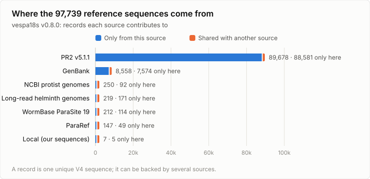

# vespa-18s-refdb

Builds the 18S V4 reference database for VESPA-primer metabarcoding:
everything the primers amplify, trimmed to the amplicon, with taxonomy,
resolution tables and the adapter look-alike mask. It is consumed by
[nf-helminth-amplicon](https://github.com/stephenrdoyle/nf-helminth-amplicon) in its
`--reference_database` mode, and kept separate from it because building
a reference is its own job - its own inputs, its own release cycle - and
its output is a versioned artefact, not a pipeline step.

**Status: exploratory scripts and first measurements. No release has
been built yet.** See [docs/DESIGN.md](docs/DESIGN.md) for the design,
what PR2 and the WormBase ParaSite genomes look like through these
primers, and the release format the pipeline expects.

<picture>
  <source media="(prefers-color-scheme: dark)" srcset="docs/figures/sources_dark.svg">
  
</picture>

<picture>
  <source media="(prefers-color-scheme: dark)" srcset="docs/figures/taxa_dark.svg">
  
</picture>

Figures are drawn from the current release by `bin/readme_figures.py`,
which also prints the two `<picture>` blocks above, alt text included;
after a release, rerun it and paste its output over them:
`python3 bin/readme_figures.py releases/vespa18s_<version> docs/figures`.

Primers, as ordered (locus-specific parts; both carry Nextera tails):

- `AMPSEQ_VESPA18S_29F` `AGCAGCCGCGGTAATTCC`
- `AMPSEQ_VESPA18S_21b8_I_R_Nmod` `TCCGTCAATTYCTTNAASTTTC`

## Layout

| path | |
|---|---|
| `bin/pr2_layer.py` | **Build.** Layer 1: PR2 (taxo_long, with accessions) trimmed to the V4 insert |
| `bin/wbps_layer.py` | **Build.** Layer 2: genome V4 filtered by copy support and phylum, given PR2 ranks (NCBI lineage where PR2 lacks the genus) |
| `bin/collapse.py` | **Build.** Collapses layers into unique inserts, merges taxonomy, resolves label conflicts; writes `refdb.fasta`, `taxonomy.tsv`, `members.tsv`, `conflicts.tsv` |
| `bin/release.py` | **Build.** Cuts a release: resolution tables, look-alike mask, manifest, tarball |
| `bin/genbank_fetch.py`, `bin/genbank_layer.py` | **Build.** GenBank 18S for named taxa; the layer keeps what PR2 lacks |
| `bin/pararef_insilico_pcr.py`, `bin/pararef_layer.py` | **Build.** Streams the ParaRef archive; its layer, under the genome rules |
| `bin/local_layer.py`, `local/sequences.tsv` | **Build.** Our own sequences, hand-curated, most trusted |
| `bin/genome_insilico_pcr.py` | Scans any one genome, URL or file |
| `bin/ncbi_genomes_insilico_pcr.py` | Streams every NCBI assembly for a taxon through the scan (optionally the best N per species) |
| `bin/readme_figures.py` | The README figures, light and dark SVG, from a release |
| `bin/vespa.py` | Primers, in-silico PCR and PR2 rank conventions shared by the build |
| `bin/pr2_insilico_pcr.py` | In-silico PCR over PR2; insert lengths; resolution over the whole insert (nanopore) and the 2x150 read windows (Illumina); adapter-anchor look-alikes |
| `bin/wbps_insilico_pcr.py` | Streams every WormBase ParaSite genome from the EBI FTP, finds V4 amplicons on both strands, keeps only the hits |
| `bin/compare_wbps_pr2.py` | Per genome: is the species in PR2, does its V4 match PR2 and under whose label, nearest PR2 taxon if not, possible contaminants |
| `bin/seqmatch.py` | Approximate matching and the look-alike scan, copied from nf-helminth-amplicon's `bin/ampseqlib.py`. The look-alike scan must stay identical to the pipeline's, because the pipeline reads the mask built here |
| `results/` | Reports and data from the runs the design note quotes |
| `docs/DESIGN.md` | Design, measurements, release format |

Python 3.9+, standard library only.

## Building

```bash
# sources/README.md lists what goes in sources/
python3 bin/pr2_layer.py sources/pr2_version_5.1.1_SSU_taxo_long.fasta.gz work/pr2_layer.tsv.gz 8
python3 bin/wbps_layer.py results/wbps19_v4_amplicons.tsv.gz work/pr2_layer.tsv.gz \
    work/wbps_layer.tsv.gz work/wbps_review.tsv
python3 bin/genbank_fetch.py work/genbank Nematoda Platyhelminthes Acanthocephala
python3 bin/genbank_layer.py work/pr2_layer.tsv.gz work/genbank_layer.tsv.gz \
    work/genbank_review.tsv work/genbank/*.fasta.gz
python3 bin/pararef_insilico_pcr.py work/pararef_out 6      # streams 21.8GB
python3 bin/pararef_layer.py work/pararef_out results/pararef_taxa.json \
    work/pr2_layer.tsv.gz work/pararef_layer.tsv.gz work/pararef_review.tsv
python3 bin/local_layer.py local/sequences.tsv work/pr2_layer.tsv.gz \
    work/local_layer.tsv.gz work/local_review.tsv

# Protists: NCBI genomes (3 best per species) and GenBank, per genus
python3 bin/ncbi_genomes_insilico_pcr.py Cryptosporidium work/ncbi_genomes/Cryptosporidium 6 3
python3 bin/pararef_layer.py work/ncbi_genomes/Cryptosporidium \
    work/ncbi_genomes/Cryptosporidium/taxa.json work/pr2_layer.tsv.gz \
    work/ncbi_layers/Cryptosporidium.tsv.gz work/ncbi_layers/Cryptosporidium.review.tsv NCBI_genomes
#   ... for each protist genus, then concatenate into work/ncbi_genomes_layer.tsv.gz
python3 bin/genbank_fetch.py work/genbank Cryptosporidium Giardia ...   # protist genera
python3 bin/genbank_layer.py work/pr2_layer.tsv.gz work/genbank_protist_layer.tsv.gz \
    work/genbank_protist_review.tsv <protist fasta.gz files>

# Increasing trust. (zsh: list the files; it does not word-split a variable)
python3 bin/collapse.py work/build work/genbank_layer.tsv.gz work/genbank_protist_layer.tsv.gz \
    work/pr2_layer.tsv.gz work/pararef_layer.tsv.gz work/ncbi_genomes_layer.tsv.gz \
    work/wbps_layer.tsv.gz work/local_layer.tsv.gz
python3 bin/release.py work/build releases v0.3.0 <the same layers>
```

Layers go to `collapse.py` and `release.py` in increasing order of
trust: GenBank, PR2, ParaRef, WBPS, local. Slow steps: the PR2 layer
(~10 min), the GenBank layer (~15 min; its PCR is then cached), the
ParaRef stream (~80 min). A release is never overwritten.

## Releases

| version | contents | notes |
|---|---|---|
| v0.3.0 | v0.2.0 plus protists from NCBI genomes and GenBank; 97,559 records | **current** (docs/DESIGN.md §6.3) |
| v0.2.0 | GenBank + PR2 v5.1.1 + ParaRef + WBPS19 + local; 94,028 records, 8,808 helminth | superseded; its coverage table undercounts PR2's numbered genera (§4.6) |
| v0.1.0 | PR2 v5.1.1 + WBPS19 genomes; 89,872 records | superseded: its Illumina resolution table overstates 8,775 records (§6.1 erratum); look-alike mask not yet usable by the pipeline |

Each release is `releases/vespa18s_<version>/` plus a `.tar.gz`. Only
`manifest.json` and `summary.txt` are committed; the data travel as the
tarball.

## Reproducing the exploratory measurements

```bash
# PR2 v5.1.0, DADA2 format, from https://github.com/pr2database/pr2database
python3 bin/pr2_insilico_pcr.py pr2_version_5.1.0_SSU_dada2.fasta.gz pr2_out

curl -s https://ftp.ebi.ac.uk/pub/databases/wormbase/parasite/releases/current/CHECKSUMS \
    | awk '/genomic.fa.gz$/ && !/masked/ {print $2}' > wbps_genomes.txt
python3 bin/wbps_insilico_pcr.py wbps_genomes.txt wbps_out 8

python3 bin/compare_wbps_pr2.py pr2_out/pcr_results.json wbps_out wbps_vs_pr2
```

On a laptop: PR2 in-silico PCR about 10 minutes (cached as
`pcr_results.json`, about 120MB, and reused), the look-alike scan a few
minutes, all 274 WBPS19 genomes 35 minutes on 8 workers (about 20GB
streamed, nothing kept), the comparison about 10 minutes.

## results/

| file | contents |
|---|---|
| `pr2_v5.1.0_summary.txt` | amplification, insert lengths, resolution, genera of interest, anchor look-alikes |
| `wbps19_vs_pr2.txt` | genome-versus-PR2 report |
| `wbps19_scan.tsv` | one row per WBPS19 assembly: bases scanned, amplicons, seconds (one failed download listed) |
| `curation/conflicts.tsv` | every class-level label conflict in the PR2 + WBPS19 build and how it was resolved |
| `curation/overruled.tsv` | every member label the build overruled, with its accession |
| `curation/wbps_review.tsv` | genome variants kept out as another organism's rDNA |
| `wbps19_v4_amplicons.tsv.gz` | every V4 amplicon found in WBPS19: genome, contig, strand, coordinates, primer edits, insert. Raw material for the genome layer **before** the filtering rules in the design note - it still contains host, vector and other contaminant rDNA |

## Caveats

- Resolution is a best case: "every entry with an identical sequence
  shares this genus/species". Sequencing error and missing references
  both make the real figure worse.
- Primer matching allows <= 2 edits in PR2; in genomes, <= 1 edit in the
  forward primer (seeded search) and <= 2 in the reverse.
- A genome hit is discarded if a primer site contains N or the insert is
  more than 1% N: N in a scaffold gap matches a primer for free.
- "Nearest" in the comparison is by shared 12-mers, not an alignment.

## Licence and sources

The code is under the [MIT licence](LICENSE). The database itself is
derived from public sources, which keep their own terms and should be
credited with it:

- **PR2** (Guillou et al. 2013, *Nucleic Acids Res* 41:D597;
  https://pr2-database.org) - the backbone.
- **NCBI GenBank** and **NCBI genome assemblies** - GenBank and protist
  genome layers.
- **WormBase ParaSite** (Howe et al. 2017, *Mol Biochem Parasitol*
  215:2) - helminth genome layer.
- **ParaRef** (Niemann et al. 2025, *Genome Biology*;
  doi:10.5281/zenodo.13744644, CC-BY 4.0) - genome layer; the ParaRef
  results in `results/` are derived from it.
- The primers and protocol are VESPA's (Owens et al. 2024, *Nat Commun*
  15:402).
